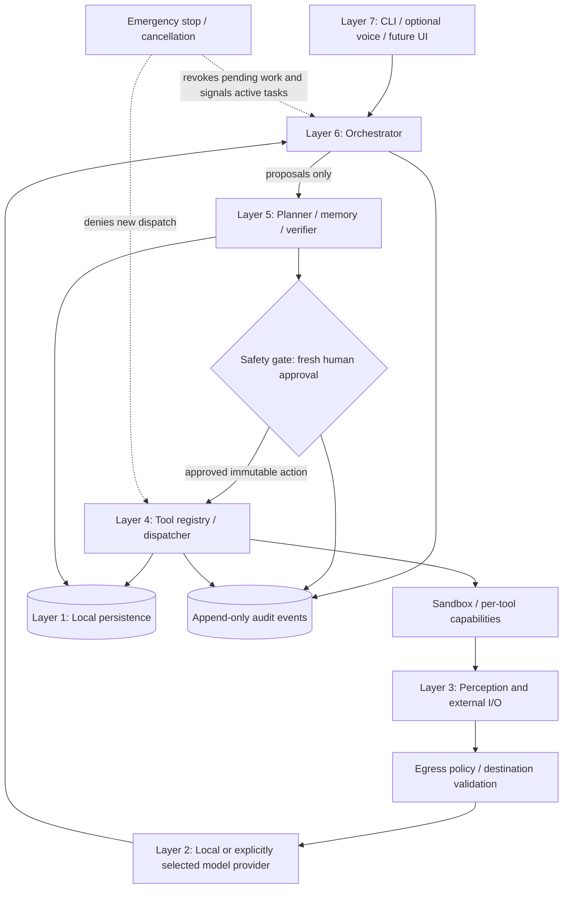

# Yuki Target Architecture and Enforcement Boundaries

**Status:** target architecture and implementation map, not a certification of implemented features.  
**Last reviewed:** 2026-10-20

This document translates the proposed seven-layer Chocolate/Yuki architecture into a safe, incremental implementation plan. The repository is Yuki; names in the supplied Chocolate tree are conceptual examples and are not evidence that those modules exist here.

## Architecture at a glance

The safety gate, egress policy, sandbox, audit trail, and emergency stop are **cross-cutting controls**, not optional tools that the model can choose to skip.

## Seven layers and current implementation status

| Layer | Intended responsibility | Current repository evidence | Gap / safe next step |
|---|---|---|---|
| 7 — Interface | CLI, explicitly enabled voice, future UI, emergency stop | Terminal runtime in `main.py`; optional voice components | Test actual end-to-end voice separately; do not claim always-on wake-word or reliable global kill switch without integration tests. |
| 6 — Orchestration | Bounded task loop, model routing, lifecycle and cancellation | `core/task_agent.py` has a bounded JSON-based model-guided loop; provider factory defaults to mock | This is not a mature native tool-calling/ReAct runtime. Add deadlines, cancellation, state recovery, and an end-to-end fake-provider test before live autonomy. |
| Safety gate | Human authorization for consequential actions | Guarded skill agent and approval-related modules/tests | Prove every execution path is gated immediately before dispatch, each approval is single-use and bound to the exact action/session, and failures deny by default. |
| 5 — Core services | Planner, memory, verification, controlled preference evolution | `core/planner.py`, `core/vector_memory.py`, knowledge modules | Planner is proposal-only; memory is lexical rather than vector-based. Learned preferences must never alter trusted policy or grant capabilities. |
| Egress boundary | Network destination and protocol restrictions | Provider HTTP helper rejects redirects; selected web skills have allow-listing | Redirect rejection alone is not an egress firewall. Add DNS/IP validation, redirect tests for every HTTP client, private/link-local address controls, and external network policy. |
| 4 — Tool registry | Typed capabilities, risk classification, dispatch | `skills/registry.py`, guarded skill agent; manifest dispatcher prototype | Avoid arbitrary plugin imports and raw shell dispatch. Add per-tool schemas, bounded outputs, idempotency, approval binding, and sandbox tests. |
| Sandbox | Isolated execution and resource limits | Docker sandbox-related code exists | A command filter is not a sandbox. Verify non-root execution, read-only mounts, dropped capabilities, network isolation, CPU/memory/PID limits, and timeout/cleanup behavior. |
| 3 — Perception | Screen/window observation, browser and web retrieval | Optional browser/web skills and integrations | Treat all retrieved text and screenshots as untrusted data; test prompt injection, credential isolation, download handling, and explicit user consent. |
| 2 — Inference | Local model, embeddings, STT/TTS | Provider adapters and optional voice modules | Default provider remains mock; real provider and voice integrations need separate opt-in acceptance tests. Do not promise fixed latency without measurements. |
| 1 — Persistence | Memory, identity/preferences, models, audit and user data | Local JSON-backed stores and lexical memory; optional integrations | Define data classification, retention, encryption, export/wipe, atomic writes, schema migrations, backups, and restore tests. Never commit live profiles, face data, tokens, or personal logs. |

## Non-negotiable security invariants

1. **Proposal is not permission.** Model output is untrusted structured data. The model cannot call the dispatcher directly or approve its own proposal.
2. **Fresh approval is action-specific.** Approval binds to actor, session, tool identifier, canonical arguments, tool/manifest version, risk level, and expiry. Any mutation or retry requiring a new action needs new approval.
3. **Authorize immediately before execution.** Re-check current policy and capability grants after approval and immediately before dispatch. Missing, stale, ambiguous, or failed approval denies execution.
4. **No shell through the general LLM loop.** Shell or code execution, if ever enabled, must be a separately reviewed capability with strict argument schema, isolated sandbox, hard resource limits, bounded output, and explicit approval.
5. **External content is data, never policy.** Web pages, browser content, documents, tool output, retrieved memory, and conversation summaries cannot modify safety policy or grant new capabilities.
6. **Egress is enforced outside the prompt.** Validate scheme, host, resolved addresses, ports, and redirect behavior at the network boundary. Revalidate after DNS resolution and redirects; do not forward credentials to a changed origin. Provider redirect refusal is only one defense.
7. **Secret minimization.** Do not log prompt bodies, tokens, cookies, authorization headers, face encodings, or full private memory by default. Audit records should prefer action identifiers, risk, approval decision, timestamps, and redacted outcome.
8. **Stop is fail-closed.** Emergency stop blocks new dispatch, invalidates pending approvals, signals active work to cancel, terminates owned child processes, and records the stop event. It must not depend on the model responding.
9. **Persistence is recoverable.** Writes are atomic where possible; schemas are versioned; backup encryption keys are stored separately from encrypted backups; restore and tamper-rejection are tested.
10. **No hidden data egress.** Telemetry, cloud providers, email, browser sessions, and remote MCP tools require explicit configuration and clear user-facing disclosure.

## Recommended implementation sequence

### Gate A — Restore reliable CI first
- Resolve Ruff findings without weakening the lint policy.
- Run formatter, type checker, package installation, CLI smoke test, and all supported Python test versions.
- Run the dependency audit, Bandit, and full-history secret scan; review and remediate findings.
- Do not start the next phase until required checks pass on the same commit.

### Gate B — Close data-protection P0s
- Inventory every tracked file and every backup/export/archive path.
- Ensure private runtime state is excluded from Git and examples contain only synthetic data.
- Rotate any exposed credentials before any history rewrite.
- Implement authenticated backup encryption, separately managed keys, tamper rejection, restore round-trip, and no-plaintext-temp tests.

### Gate C — Prove safe task execution
- Use a deterministic fake provider for unit tests; live model tests are opt-in and local by default.
- Test malformed/oversized output, unknown tools, approval denial, approval replay, wrong actor/session, altered arguments, provider timeout, tool timeout, cancellation, and partial failure.
- Require every invocation to pass the same authorization path, including direct CLI commands and background jobs.
- Add a small end-to-end task that creates files only inside a temporary workspace and never publishes or deploys them without a separate approval.

### Gate D — Prove voice and network behavior
- Voice tests cover opt-in, microphone failure, cancellation, transcript privacy, and TTS failure; hardware-dependent tests are explicitly marked manual.
- Network tests cover redirects, DNS rebinding/private addresses, SSRF, prompt injection, browser cookies, file downloads, and egress denial.
- Test the emergency stop while a tool is running, not only when the CLI is idle.

### Gate E — Release
- Publish capability claims only when linked to tests or a documented manual acceptance test.
- Build a reproducible artifact, install it in a clean environment, run the smoke test, tag a version, and publish a release checklist.
- A committed module or green isolated unit test does not by itself establish production readiness.

## Capability language

Use **implemented** only for code paths that are wired into the default or explicitly configured runtime; **tested** only for behavior covered by passing automated or documented manual acceptance tests; **production-ready** only after security, reliability, recovery, packaging, and release gates pass. Clearly label prototypes, optional integrations, and unverified behavior.
